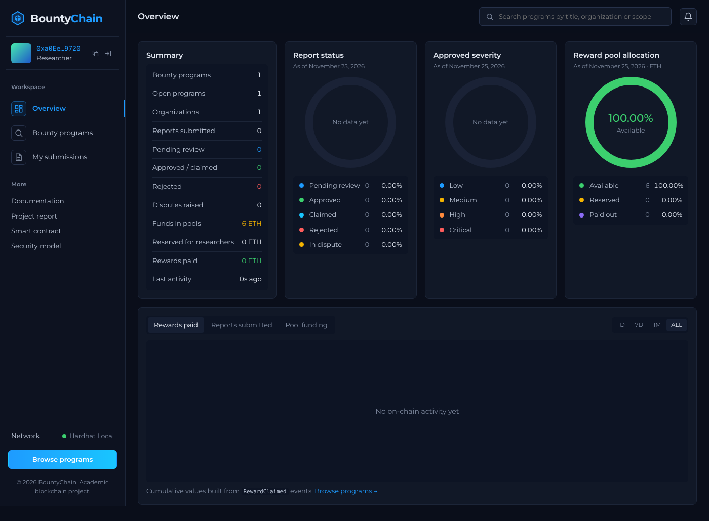
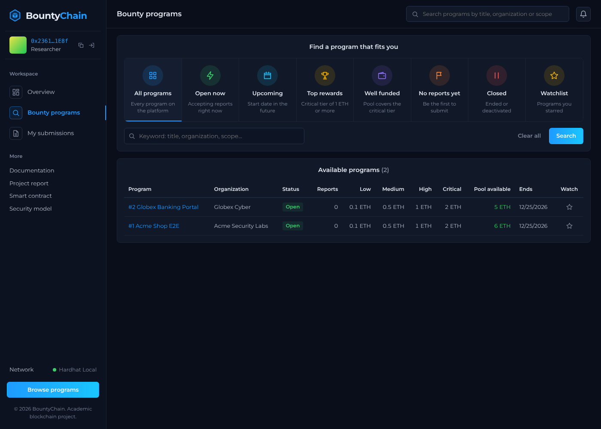
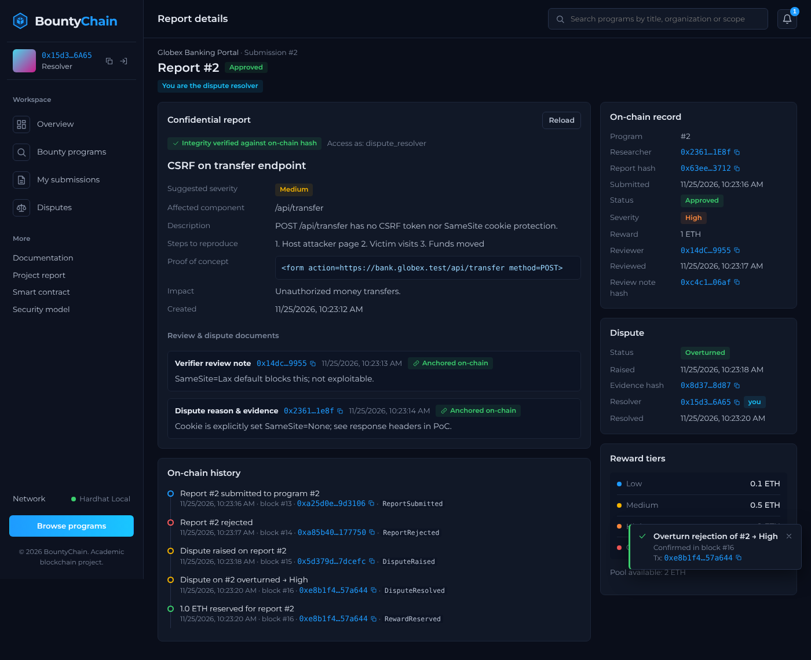
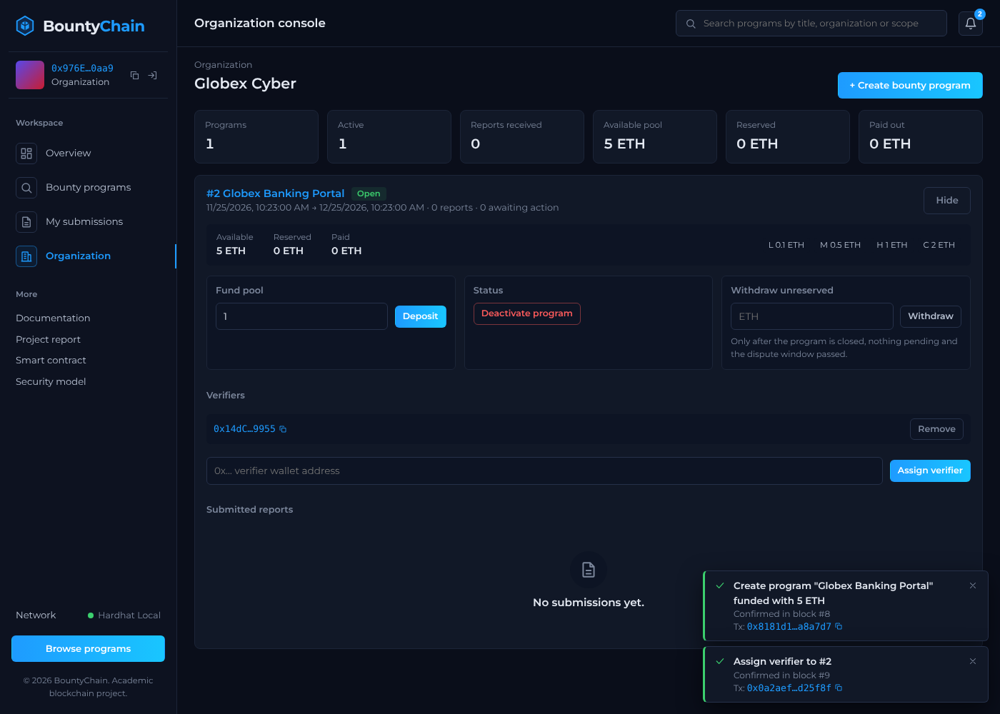

# BountyChain — Decentralized Bug Bounty & Vulnerability Reward Platform

Academic Blockchain Technology mini-project. Organizations lock bounty rewards in a smart contract, researchers submit **encrypted** vulnerability reports anchored on-chain by a keccak256 hash, assigned verifiers approve or reject them, the contract pays **exactly the predefined severity tier**, and rejected reports can be escalated to an on-chain dispute resolver.

| Layer | Tech |
|---|---|
| Smart contract | Solidity 0.8.24, Hardhat 2, OpenZeppelin 5 (`Ownable2Step`, `ReentrancyGuard`) |
| Backend | Node.js, Express, SQLite (sql.js, WebAssembly), ethers v6, JWT, AES-256-GCM |
| Frontend | React 18 + Vite, ethers v6, MetaMask |
| Tests | Hardhat/Mocha/Chai (53), Node test runner + supertest (23), live E2E script |

Full academic write-up (architecture, diagrams, schema, security, limitations): **[docs/PROJECT_REPORT.md](docs/PROJECT_REPORT.md)** · Viva demo script: **[docs/DEMO_CHECKLIST.md](docs/DEMO_CHECKLIST.md)**

| Overview | Bounty programs |
|---|---|
|  |  |
| **Report details** | **Organization console** |
|  |  |

```
bountychain/
├── blockchain/   contracts/BountyPlatform.sol, test/, scripts/deploy.js, hardhat.config.js
├── backend/      src/ (app, auth, access, crypto, chain, db), test/, scripts/e2e.js
├── frontend/     src/ (pages, components, context, lib)
└── docs/         PROJECT_REPORT.md, DEMO_CHECKLIST.md, test results
```

---

## 1. Prerequisites

- **Node.js 20 LTS or 22 LTS** (includes npm) — https://nodejs.org
- **MetaMask** browser extension (Chrome / Edge / Firefox / Brave)
- Git (optional)

Windows note: the backend uses `sql.js` (SQLite compiled to WebAssembly), so there are no native modules: no Visual Studio / C++ build tools are needed on any Node version.

## 2. Install (once)

PowerShell (from the `bountychain` folder):

```powershell
npm run setup
```

That runs `npm install` in `blockchain`, `backend` and `frontend`, and creates `backend\.env` with fresh random secrets. Manual equivalent:

```powershell
cd blockchain; npm install; cd ..
cd backend;    npm install; npm run gen-env; cd ..
cd frontend;   npm install; cd ..
```

## 3. Compile and test the contract

```powershell
cd blockchain
npx hardhat compile
npx hardhat test          # 53 tests: positive + negative cases
cd ..\backend
npm test                  # 23 backend authorization / crypto tests
```

## 4. Run the full stack locally (4 terminals)

| Terminal | Command | What it does |
|---|---|---|
| 1 | `cd blockchain` → `npx hardhat node` | Local Ethereum chain on `http://127.0.0.1:8545`, chainId **31337**, 20 funded accounts |
| 2 | `cd blockchain` → `npm run deploy:local` | Deploys `BountyPlatform`; writes address+ABI to `frontend/src/contracts/` and `backend/contract/` |
| 3 | `cd backend` → `npm start` | API on `http://localhost:4000` |
| 4 | `cd frontend` → `npm run dev` | UI on `http://localhost:5173` |

> Restarting `hardhat node` wipes the chain. Then re-run step 2, and delete `backend\data\` (old reports reference the old chain): `Remove-Item -Recurse -Force backend\data`

Optional automated check (with terminals 1–3 running): `cd backend; npm run e2e` — performs the entire workflow with real transactions and asserts every result.

## 5. Configure MetaMask for the local chain

1. MetaMask → network selector → **Add network → Add a network manually**
   - Network name: `Hardhat Local` · RPC URL: `http://127.0.0.1:8545` · Chain ID: `31337` · Currency: `ETH`
   (The app also offers a **Switch network** button that adds it automatically.)
2. Import test accounts: **Account menu → Add account → Import account** and paste private keys printed by `npx hardhat node`. Suggested role mapping:

| Hardhat account | Role in demo |
|---|---|
| #0 `0xf39F…2266` | Platform Administrator (deployer) |
| #1 `0x7099…79C8` | Organization |
| #2 `0x3C44…93BC` | Security Verifier |
| #3 `0x90F7…b906` | Researcher |
| #4 `0x15d3…6A65` | Dispute Resolver |

> These keys are public test keys. **Never** send real funds to them or use them on mainnet.

3. After restarting the Hardhat node, MetaMask may show "nonce too high": **Settings → Advanced → Clear activity tab data** for each account.

Shortcut for rehearsals: `cd blockchain; npm run seed:local` registers #1 as organization and #4 as dispute resolver (in a viva, do it live in the Admin Panel instead).

## 6. Demo workflow (acceptance criteria)

1. **Admin (#0)** → *Admin Panel*: register organization #1, assign dispute resolver #4.
2. **Organization (#1)** → *Organization*: create program (details, dates, 4 reward tiers, initial funding) → assign verifier #2.
3. **Researcher (#3)** → *Explore Programs* → program → fill report → *Encrypt & submit* (sign login message, then confirm tx).
4. **Verifier (#2)** → *Verifier* → open report → *Decrypt & view* → write note → choose severity → *Approve*.
5. **Researcher** → *My Submissions* → *Claim* (real ETH transfer, check MetaMask balance).
6. Submit a second report; verifier *Reject*s it; researcher opens it → *Raise dispute*.
7. **Resolver (#4)** → *Dispute Resolution* → open → decrypt report + evidence → *Overturn & approve* (or *Uphold*).
8. Show tx hashes in toasts / timelines, unauthorized pages ("Not authorized"), and a reverted unauthorized action.

Details and talking points: [docs/DEMO_CHECKLIST.md](docs/DEMO_CHECKLIST.md).

## 7. Optional: Sepolia testnet

```powershell
cd blockchain
Copy-Item .env.example .env      # fill SEPOLIA_RPC_URL and DEPLOYER_PRIVATE_KEY (a test wallet with Sepolia ETH)
npm run deploy:sepolia
```

Then set `backend\.env` → `RPC_URL=<your Sepolia RPC>` and create `frontend\.env` with `VITE_RPC_URL=<your Sepolia RPC>`. The UI shows Etherscan links automatically on Sepolia.

## 8. Environment variables

| File | Variable | Purpose |
|---|---|---|
| `backend/.env` | `JWT_SECRET` | HMAC key for session tokens (≥32 chars) |
| | `REPORT_ENCRYPTION_KEY` | 64-hex AES-256-GCM key for reports at rest |
| | `RPC_URL`, `PORT`, `CORS_ORIGIN`, `JWT_TTL`, `DB_PATH` | runtime config |
| `blockchain/.env` | `SEPOLIA_RPC_URL`, `DEPLOYER_PRIVATE_KEY`, `ADMIN_ADDRESS` | only for testnet deploy |
| `frontend/.env` | `VITE_API_URL`, `VITE_RPC_URL` | backend URL and read-only RPC |

`.env` files are git-ignored. Only `.env.example` templates are committed.

## 9. Troubleshooting

| Symptom | Fix |
|---|---|
| UI says "Contract not deployed yet" | Run `npm run deploy:local`, then restart `npm run dev` |
| "Cannot reach backend" | Start `backend` (`npm start`); check `VITE_API_URL` |
| Backend exits "Missing REPORT_ENCRYPTION_KEY" | `cd backend; npm run gen-env` |
| "Off-chain report not found" after restarting node | Delete `backend\data\` and redeploy (chain and DB must match) |
| MetaMask "nonce too high" / stuck tx | Clear activity tab data (see §5) |
| PowerShell blocks `npx` scripts | `Set-ExecutionPolicy -Scope CurrentUser RemoteSigned` |

## 10. Limitations

Academic demonstration, **not audited**. Centralized backend holds the encryption key and is trusted for confidentiality; single dispute resolver; no on-chain reputation. See *Limitations & Future Work* in [docs/PROJECT_REPORT.md](docs/PROJECT_REPORT.md).
