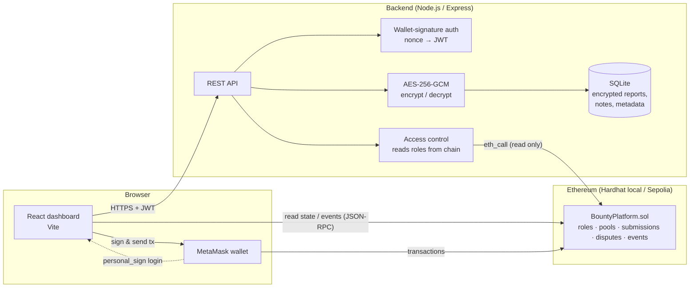
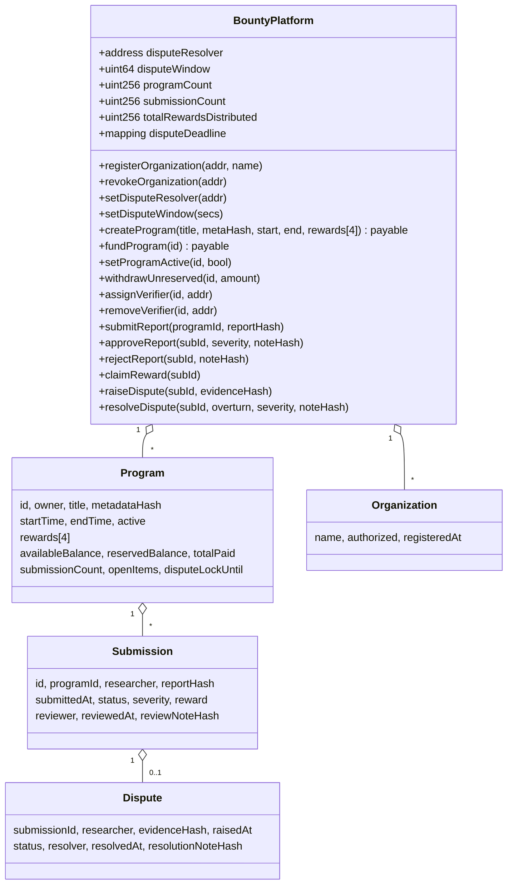
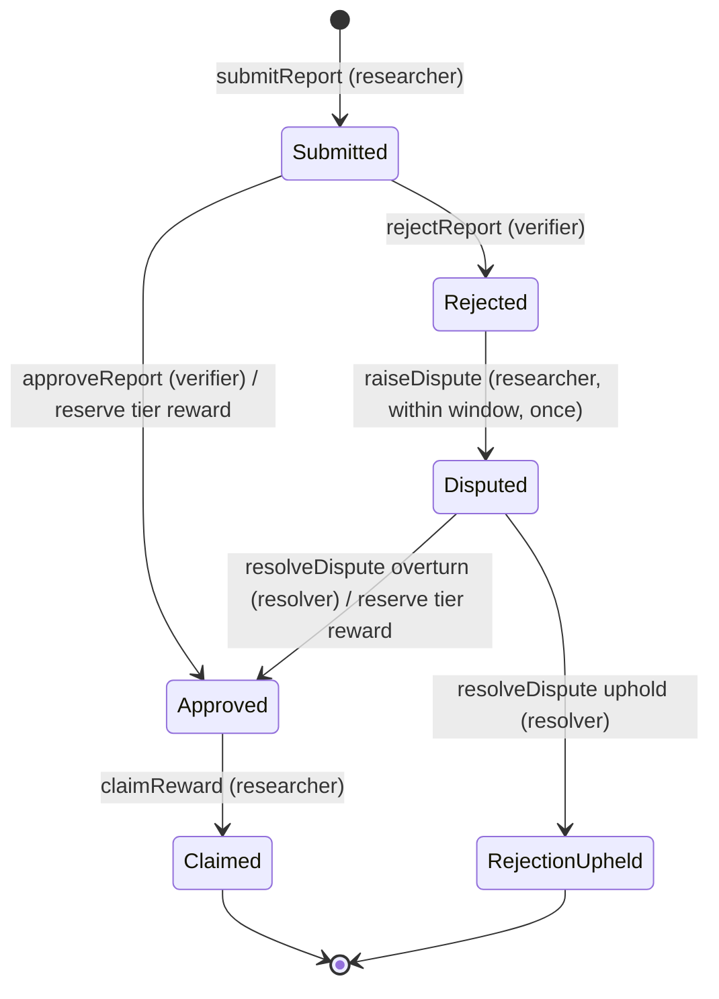
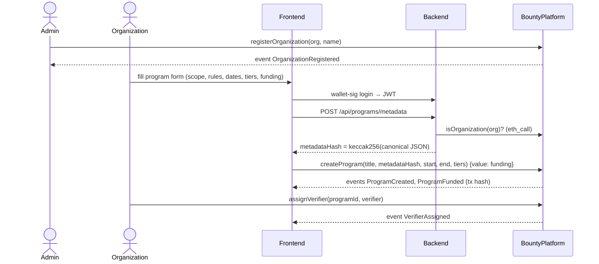
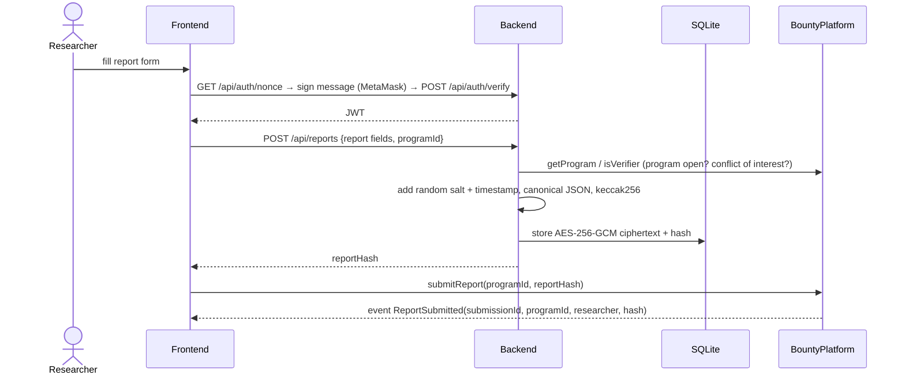
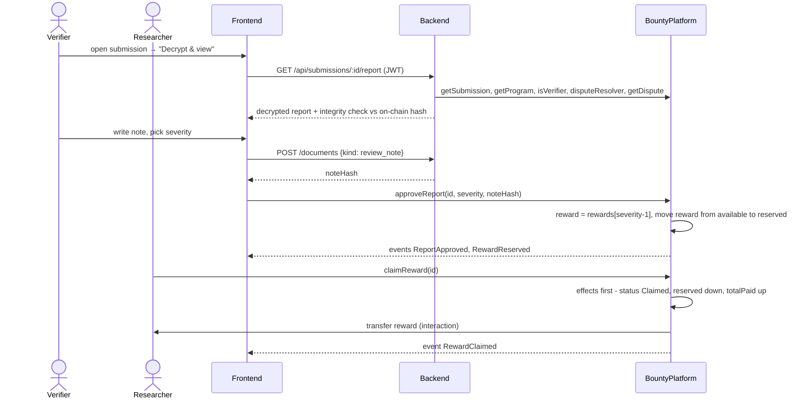
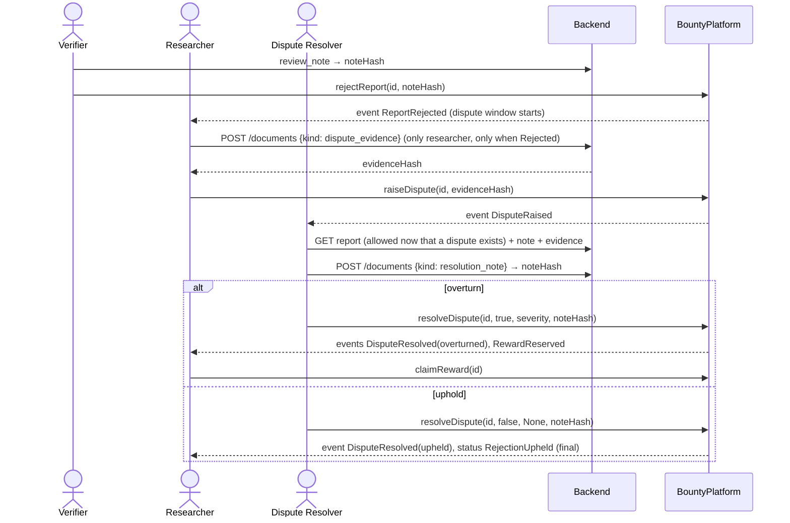
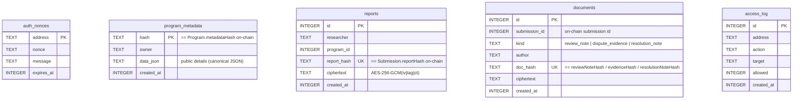

# BountyChain: Decentralized Bug Bounty and Vulnerability Reward Platform

*Blockchain Technology mini-project report*

---

## 1. Abstract

BountyChain is a hybrid blockchain application for running bug bounty programs. Organizations publish security challenges and lock their reward pool in an Ethereum smart contract. Cybersecurity researchers submit vulnerability reports, which are encrypted and kept off-chain while their keccak256 hash, the researcher's address and a timestamp are recorded on-chain. Verifiers assigned to the program approve or reject each report. An approval names a severity, and the contract then reserves the reward for that tier. The verifier never enters an amount. Researchers withdraw their rewards with a pull-payment `claimReward` call. A rejected report can be disputed within a time window, and a dispute resolver records the final decision on-chain. The system makes authorisation, fund custody, decisions and payouts transparent and tamper-evident, and it keeps exploit details confidential.

## 2. Problem Statement

Traditional bug bounty platforms are centralized intermediaries:

- **Opaque decisions:** researchers cannot verify why or when a report was rejected or downgraded, and records can be edited after the fact.
- **Payment risk:** rewards are promised, not escrowed. An organization can delay or refuse payment, or quietly lower the amount.
- **No verifiable priority:** if two researchers find the same bug, it is hard to prove who reported first or that a report was not changed later.
- **Single point of trust:** the platform operator controls records, funds and dispute outcomes.

At the same time, vulnerability details are sensitive. Publishing them on a public blockchain would expose unpatched systems.

## 3. Objectives

1. Hold reward funds in a smart contract with per-program **available** and **reserved** balances.
2. Enforce **role-based authorisation on-chain** for five roles: admin, organization, researcher, verifier and dispute resolver.
3. Record a **tamper-evident hash** of each report and of every review note or piece of dispute evidence, without publishing the content.
4. Make rewards **deterministic**: severity maps to the reward tier the organization set in advance.
5. Provide a **secure claim mechanism**: pull payments, Checks-Effects-Interactions and a reentrancy guard.
6. Implement an **on-chain dispute process** with a time window, duplicate prevention and final outcomes.
7. Protect report confidentiality off-chain with **wallet-signature authentication, server-side authorisation derived from chain state, and AES-256-GCM encryption at rest**.
8. Deliver a usable, role-aware web dashboard and a test suite that includes negative tests.

## 4. Proposed Solution

A **hybrid architecture**. Each piece of data lives where it gains the most:

| On-chain (BountyPlatform contract) | Off-chain (Express + SQLite) |
|---|---|
| Organization authorisation, dispute resolver, verifier assignments | Full program description, scope, rules (public, hash on-chain) |
| Program id, title, metadata hash, dates, reward tiers, pool balances | Full report: description, steps, PoC, impact (**encrypted**) |
| Submission id, researcher, report hash, timestamp, status, severity, reward | Verifier notes, dispute evidence, resolution notes (**encrypted**, hash on-chain) |
| Review decision, dispute raise and outcome | Wallet-login nonces, access log |
| All important events | |

Because everything off-chain is hashed with a canonical JSON serialisation, anyone holding the plaintext can recompute the hash and compare it with the contract. The UI shows an **"Integrity verified"** badge when the two match.

## 5. Technology Stack

| Area | Choice | Why |
|---|---|---|
| Contract language | Solidity 0.8.24 | Built-in overflow checks, custom errors |
| Framework | Hardhat 2 + hardhat-toolbox | Compile, local node, Mocha/Chai tests, deploy scripts |
| Security libs | OpenZeppelin 5: `Ownable2Step`, `ReentrancyGuard` | Audited building blocks |
| Chain library | ethers.js v6 | Used by frontend, backend and tests |
| Wallet | MetaMask (EIP-1193) | Standard browser wallet |
| Frontend | React 18 + Vite, React Router | Fast dev server, component model |
| Backend | Node.js + Express 5 | Simple REST API |
| Database | SQLite (better-sqlite3) | Zero-config, single file, works on Windows |
| Crypto | Node `crypto` AES-256-GCM, JWT (HS256) | No paid services |
| Testing | Hardhat (Mocha/Chai), `node:test` + supertest, Playwright run for UI flows | |

## 6. System Architecture

Design notes:

- The backend **holds no private key** and never sends transactions. It only reads the contract to decide who may see which report. A compromised backend therefore cannot move funds or change decisions.
- Every state-changing action is signed by the user's own wallet.
- The frontend hides controls by role for usability only. The contract and backend enforce every rule independently.

## 7. Smart Contract Architecture

Single contract **`BountyPlatform`** (`blockchain/contracts/BountyPlatform.sol`), inheriting `Ownable2Step` (owner = platform admin) and `ReentrancyGuard`. Two helper contracts in `contracts/test/` are used **only by tests** to simulate a malicious or non-payable researcher.

### 7.1 Enums

- `Severity { None, Low, Medium, High, Critical }`
- `SubmissionStatus { None, Submitted, Approved, Rejected, Disputed, RejectionUpheld, Claimed }`
- `DisputeStatus { None, Open, Upheld, Overturned }`

### 7.2 Submission state machine

Each function checks the current status first. Any other transition reverts with `InvalidStatus`.

### 7.3 Reward pool accounting

For each program: `contract funds held for program = availableBalance + reservedBalance`.

| Operation | available | reserved | totalPaid |
|---|---|---|---|
| `createProgram` / `fundProgram` (+v) | +v | | |
| approve / overturn (tier r) | −r (reverts `InsufficientPool` if available < r) | +r | |
| `claimReward` (r) | | −r | +r |
| `withdrawUnreserved` (a) | −a | | |

Reserved funds cannot be withdrawn by the organization, so an approved researcher is always paid. `withdrawUnreserved` is allowed only when the program is inactive or ended, `openItems == 0` (no pending review or open dispute), and `disputeLockUntil` (the latest dispute deadline of any rejection) has passed. Otherwise a late dispute could find the pool empty.

### 7.4 Function reference

| Function | Caller | Checks | Effect / events |
|---|---|---|---|
| `registerOrganization(org, name)` | admin | non-zero, name non-empty, not admin, not already authorised | authorise org · `OrganizationRegistered` |
| `revokeOrganization(org)` | admin | org authorised | stops new programs (existing ones keep running) · `OrganizationRevoked` |
| `setDisputeResolver(addr)` | admin | non-zero, **≠ admin** | `DisputeResolverChanged` |
| `setDisputeWindow(secs)` | admin | 1 h ≤ secs ≤ 90 days | applies to future rejections only · `DisputeWindowChanged` |
| `createProgram(...)` payable | authorised org | title and hash non-empty, end > start and > now, tiers > 0 and non-decreasing, `msg.value > 0` | new program, pool = msg.value · `ProgramCreated`, `ProgramFunded` |
| `fundProgram(id)` payable | program owner | value > 0 | available += value · `ProgramFunded` |
| `setProgramActive(id, b)` | program owner | | `ProgramStatusChanged` |
| `withdrawUnreserved(id, amt)` | program owner | closed, no open items, window passed, amt ≤ available; `nonReentrant` | CEI transfer · `FundsWithdrawn` |
| `assignVerifier(id, v)` / `removeVerifier` | program owner | non-zero, ≠ admin, ≠ program owner, not duplicate / assigned | `VerifierAssigned` / `VerifierRemoved` |
| `submitReport(id, hash)` | anyone except program owner and its verifiers | program active and within dates, hash ≠ 0, hash never used | `Submitted` · `ReportSubmitted` |
| `approveReport(sid, sev, note)` | assigned verifier, not the researcher | status Submitted, sev ≠ None, pool ≥ tier | reserve tier · `ReportApproved`, `RewardReserved` |
| `rejectReport(sid, note)` | assigned verifier, not the researcher | status Submitted, note hash ≠ 0 | `Rejected`, stores `disputeDeadline = now + disputeWindow` · `ReportRejected` |
| `claimReward(sid)` | the researcher | status Approved; `nonReentrant` | Claimed, reserved −= r, transfer · `RewardClaimed` |
| `raiseDispute(sid, evidence)` | the researcher | no prior dispute, status Rejected, now ≤ stored `disputeDeadline`, evidence ≠ 0 | `Disputed` · `DisputeRaised` |
| `resolveDispute(sid, overturn, sev, note)` | dispute resolver; not the researcher, original reviewer, program owner or a program verifier | dispute Open, status Disputed, note ≠ 0; overturn → sev ≠ None and pool ≥ tier; uphold → sev = None | Approved + reserve, or RejectionUpheld · `DisputeResolved` (+ `RewardReserved`) |
| views | anyone | | `getProgram`, `getSubmission`, `getDispute`, `getRoles`, `getStats`, lists per org / verifier / researcher / program |

## 8. Data Flow and Transaction Flow

### 8.1 Bounty program creation

### 8.2 Vulnerability report submission

### 8.3 Verification and reward distribution

### 8.4 Dispute resolution

## 9. User Roles

| Role | Identified by | Can | Cannot |
|---|---|---|---|
| **Platform Administrator** | contract `owner()` (deployer, transferable with 2-step) | register or revoke organizations, set dispute resolver and dispute window, view platform stats and activity | approve or reject reports (not a verifier; the contract refuses admin as verifier, as resolver and as organization) |
| **Organization** | `isOrganization(addr)` | create, fund, activate or deactivate programs; assign or remove verifiers (not itself); view and decrypt reports to its programs; withdraw unreserved funds after closing | review reports, submit to own program, touch reserved rewards |
| **Researcher** | any wallet | browse programs, submit reports, track status, claim own rewards, dispute own rejected reports | modify a submitted report (hash is immutable), approve anything, claim someone else's reward |
| **Security Verifier** | `isVerifier(programId, addr)` (per program) | decrypt reports of assigned programs, approve with a severity, reject with a note | choose a reward amount, review own submission, submit to the program they verify |
| **Dispute Resolver** | `disputeResolver` address | read disputed reports and evidence, uphold or overturn with a severity | resolve own dispute, act on non-disputed reports, reopen resolved disputes |

## 10. Database Schema (SQLite)

Links to the chain are **by hash**. A report row is linked to a submission by looking up `report_hash = getSubmission(id).reportHash`. The row's `researcher` must equal the on-chain researcher, so a draft can never be attached to someone else's submission.

### REST API

| Method & path | Auth | Purpose |
|---|---|---|
| `GET /api/auth/nonce?address=` | – | one-time sign-in message (5 min TTL) |
| `POST /api/auth/verify` | – | verify `personal_sign` signature → JWT (2 h) |
| `POST /api/programs/metadata` | JWT + on-chain organization | store public program details, return hash |
| `GET /api/programs/metadata/:hash` | – | public details + integrity flag |
| `POST /api/reports` | JWT (not program owner or verifier) | encrypt and store report, return `reportHash` |
| `GET /api/submissions/:id/report` | JWT + researcher / owner / verifier / resolver-if-disputed | decrypt report + documents + integrity |
| `GET /api/submissions/titles?ids=` | JWT | titles for authorised ids only |
| `POST /api/submissions/:id/documents` | JWT + role and status rule | store note or evidence, return hash for the contract call |

## 11. Security Measures

### Smart contract
| Threat | Mitigation |
|---|---|
| Reentrancy | `nonReentrant` on `claimReward` and `withdrawUnreserved`; Checks-Effects-Interactions (state updated before the `call`). Tested with a malicious `ReentrantResearcher`. |
| Unauthorised access | Custom modifiers (`onlyOwner`, `onlyOrganization`, `onlyProgramOwner`, `onlyDisputeResolver`) plus inline verifier and researcher checks. Every negative path is tested. |
| Admin overreach | Admin cannot be organization, verifier or resolver, and the admin role cannot be transferred to a wallet holding any of those roles (`ConflictOfInterest`). |
| Conflict of interest | Owner and verifiers cannot submit to their program; an org cannot verify its own program; a verifier cannot decide on their own report; the resolver must not be the researcher, original reviewer, program owner or a program verifier. |
| Retroactive rule changes | Dispute deadline is fixed per submission at rejection time; changing `disputeWindow` never shortens a running window. |
| Metadata impersonation | Frontend only shows off-chain program details whose publisher equals the on-chain program owner. |
| Arbitrary payouts | Reward is always `rewards[severity-1]`. No amount parameter exists. |
| Over-payment / insolvency | Reserve only if `available ≥ reward`; reserved funds cannot be withdrawn; invariant `balance = Σ(available + reserved)` is tested. |
| Double claim / replay | Status moves to `Claimed` before transfer; duplicate report hashes are rejected globally. |
| Invalid transitions | Explicit status check in every mutating function. |
| Failed transfer | `call` result checked → `TransferFailed` revert, so the whole tx rolls back and accounting is untouched (tested with `RejectingResearcher`). |
| Zero address / empty input | `ZeroAddress`, `EmptyValue` checks. |
| Integer errors | Solidity 0.8 checked arithmetic. |
| Stray ETH | `receive()` reverts, so funds only enter through `createProgram` and `fundProgram`. |
| Admin key loss / typo | `Ownable2Step` requires the new admin to accept ownership. |
| Visibility | Storage is `private` with explicit view getters; internal helpers are `internal` or `private`. |

### Backend / off-chain
| Threat | Mitigation |
|---|---|
| Exploit details leaking publicly | Never on-chain; AES-256-GCM at rest with a key from `.env`; GCM auth tag detects DB tampering. |
| Hash brute-force (guessing report contents from the hash) | 128-bit random salt in every hashed document. |
| Impersonation | Wallet-signature login; nonce is single-use with a 5 min expiry; recovered address must match. |
| Broken access control | Authorisation computed per request from **on-chain** state (owner, `isVerifier`, resolver plus dispute existence). Removed verifiers lose access immediately. |
| Accountability | `access_log` records allowed and denied reads and writes. |
| Brute force / abuse | Per-IP rate limit on auth endpoints, 256 kB body limit, input length validation. |
| Secrets in code | All secrets come from env vars; `.env` is git-ignored; `npm run gen-env` creates random values. |
| Hidden buttons ≠ security | Frontend role gating is UX only; contract and API enforce every rule. |

## 12. Testing Strategy and Results

1. **Contract unit tests** (`blockchain/test/BountyPlatform.test.js`, Hardhat network, fixtures + time travel): **53 passing**, covering organization, programs, verifier, submission, rewards and disputes, with explicit negative tests for every unauthorised or invalid path, reentrancy and failed transfers. Output: [test-results-contract.txt](test-results-contract.txt).
2. **Backend tests** (`backend/test/api.test.js`, mocked chain reader, in-memory SQLite): **23 passing**. Covers signature auth (wrong signer, replay, forged token), encryption at rest, salted hashes, validation, restricted report access for each role, removed verifier, tamper detection, document permission rules and metadata. Output: [test-results-backend.txt](test-results-backend.txt).
3. **End-to-end integration** (`backend/scripts/e2e.js`, real Hardhat node, deployed contract and running backend): the full acceptance workflow with real transactions and assertions for all five roles, including 14 rejected unauthorised or invalid operations. Output with tx hashes and the emitted-event summary: [test-results-e2e.txt](test-results-e2e.txt).
4. **UI flow check**: a headless Chromium run drove the React app with a test EIP-1193 wallet bound to the Hardhat node. It covered admin registration, program creation and funding, verifier assignment, report submission, a stranger being refused access, verifier approval, claim, rejection, dispute, overturn and a second claim, with no unexpected console errors.

Requirement-to-test mapping (selected):

| Requirement | Test |
|---|---|
| Admin registers org / unauthorised cannot | `Organization › admin can register…`, `…unauthorized wallets cannot register…` |
| Unauthorised cannot create programs | `…unauthorized wallets cannot create programs` |
| Invalid program data rejected | `Bounty programs › empty or invalid program data is rejected` |
| Inactive or expired programs refuse submissions | `inactive…`, `expired…`, `not-yet-started…` |
| Verifier cannot approve own submission | `verifiers cannot approve their own submissions…` |
| Duplicate hashes rejected | `duplicate report hashes are rejected…` |
| Sensitive data not on-chain | `sensitive report contents are not stored…` (checks ABI, calldata, logs) |
| Claims: own only, once, not when rejected | `Rewards › …` (6 tests) |
| Insufficient funding prevents payout | `insufficient reward funding prevents an invalid payout` |
| Accounting after claims | `reward accounting remains correct after claims` (balance invariant) |
| Dispute rules | `Dispute resolution › …` (10 tests) |
| Backend restricted access | `restricted report access › …` (7 tests) |

## 13. Deployment

See the top-level [README](../README.md) for exact commands, including PowerShell. In summary: `npm run setup` → `npx hardhat node` → `npm run deploy:local` (writes ABI and address to frontend and backend) → `npm start` (backend) → `npm run dev` (frontend) → add Hardhat network and test accounts to MetaMask. Sepolia deployment is optional and uses `blockchain/.env` (`SEPOLIA_RPC_URL`, `DEPLOYER_PRIVATE_KEY`).

## 14. Limitations

- **Trusted backend for confidentiality.** The server holds the AES key and decides who sees plaintext. The blockchain guarantees the integrity, authorisation and payment parts, not the confidentiality. A compromised server could leak reports, but could not alter them undetected (hash mismatch) and could not move funds.
- **Single dispute resolver.** This is a central point of trust for disputes. It is restricted to disputed reports and is not the admin, but it is still one address.
- **Hash proves existence and integrity, not originality.** Two researchers can report the same bug with different text. Deduplication is left to the verifier.
- **Severity judgement is human.** The contract enforces the mapping from severity to reward, not the correctness of the severity.
- **Gas cost / scalability.** List getters return whole arrays. This is fine for a demo but would need pagination or an indexer (for example The Graph) at scale.
- **Key management.** Losing `REPORT_ENCRYPTION_KEY` makes stored reports unreadable. There is no key rotation.
- **Not audited.** This is an academic project and must not hold real funds.

## 15. Future Enhancements

- End-to-end encryption: the researcher encrypts to the program's verifier public keys in the browser, so the server stores ciphertext it cannot read.
- A multi-member dispute committee (m-of-n voting) or Kleros-style decentralized arbitration.
- ERC-20 stablecoin reward pools; partial or bonus rewards within tier bounds.
- Researcher reputation (soulbound tokens for accepted findings).
- Commit-reveal for priority proofs; encrypted IPFS storage with key management.
- Event indexing (The Graph) and email or Push notifications.
- A formal verification and audit pass (Slither, Echidna fuzzing of the accounting invariant).
